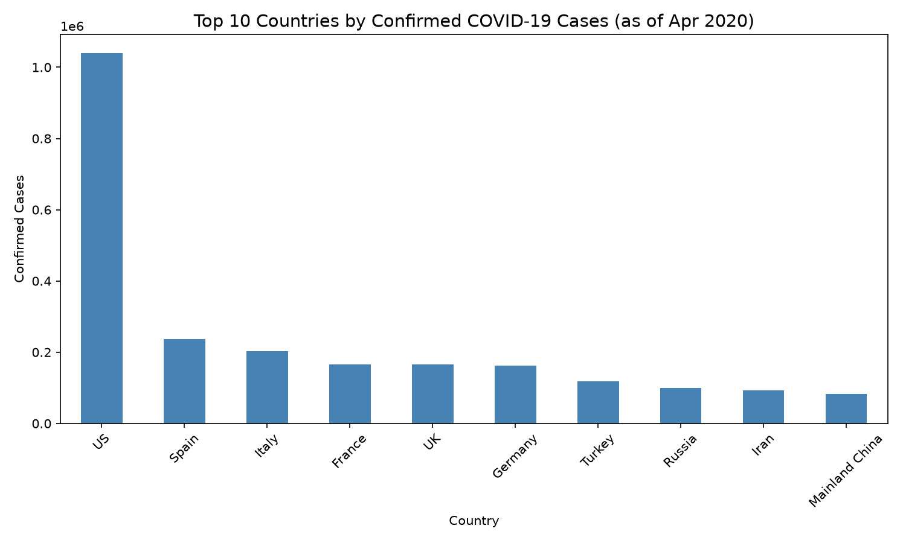
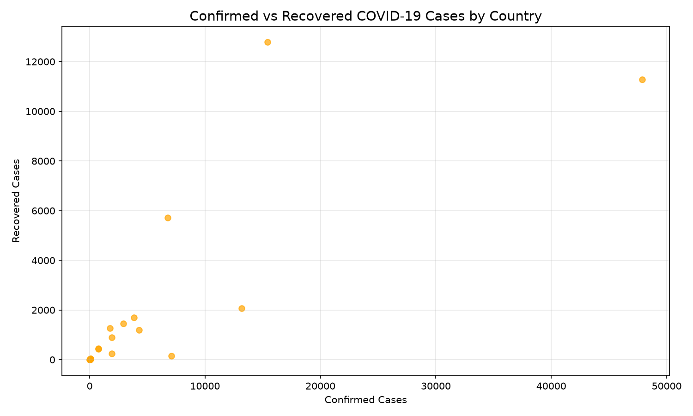

# LENG YU

## About Me
I am a Master's student in Data Science at the University of Macau. I am passionate about data analysis, machine learning, and turning raw data into meaningful insights.

## Technical Skills
- **Programming Languages:** Python, Java, SQL
- **Data Analysis:** pandas, NumPy, matplotlib, seaborn
- **Machine Learning:** scikit-learn
- **Tools & Technologies:** Jupyter Notebook, Git, GitHub

## Project Showcase

### COVID-19 Data Analysis
- **Research Question:** What is the global distribution of confirmed COVID-19 cases as of April 2020, and how do confirmed and recovered cases compare across different countries?
- **Project Repository:** [data-science-project](https://github.com/MC65194-LENG/data-science-project)
- **Project Status:** ✅ Completed

**Key Finding:** The US had the highest number of confirmed COVID-19 cases as of April 2020, followed by Spain and Italy.

**Key Finding:** There is a positive correlation between confirmed cases and recovered cases across countries, though recovery rates vary significantly.
